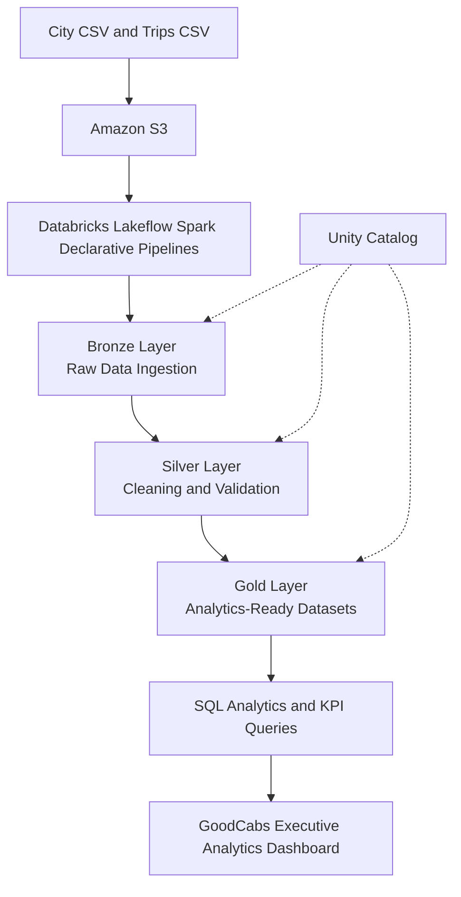

#  GoodCabs — End-to-End Data Engineering & Analytics — LakeFlow Spark Declarative Pipeline

The project transforms raw cab-trip data into structured, city-specific datasets and business insights, supported by SQL analysis and an executive analytics dashboard.


<p align="center">
  
  
  
  
  
</p>

---

##  1. Project Overview

GoodCabs is a transportation data engineering and analytics project based on a simulated cab service operating across multiple cities in India.

This project uses **Databricks Lakeflow Spark Declarative Pipelines, AWS S3, PySpark, SQL, and the Medallion Architecture** to transform raw city and trip data into structured datasets for business analysis.

Alongside the data pipeline, I developed additional SQL queries, KPI calculations, data quality checks, and the **GoodCabs Executive Analytics** dashboard.

##  2. Business Problem

As a cab service expands across multiple cities, business teams need reliable and city-specific data to understand operational performance.

The key challenges addressed by this project are:

- 🔴 **Delayed insights:** Business teams need timely access to trip and revenue information.
- 🔴 **Limited regional visibility:** Generic reports may not provide sufficient city-level detail.
- 🔴 **Manual data preparation:** Repeated data preparation can make reporting more time-consuming.
- 🔴 **Data quality concerns:** Invalid, incomplete, or duplicate records can affect analytical reliability.
- 🔴 **Fragmented reporting:** Managers need a consistent way to compare cities, passenger categories, and business trends.

###  Project Objectives

- Build a structured data pipeline using Databricks.
- Ingest source data stored in Amazon S3.
- Clean, standardize, and validate data across Bronze, Silver, and Gold layers.
- Prepare city-specific datasets for regional analysis.
- Develop SQL queries for KPIs, business trends, and data quality.
- Build an executive dashboard to visualize key business metrics.

##  3. Project Architecture

The architecture follows a layered data processing workflow, from source data ingestion to business intelligence.



###  Pipeline Flow

1. **Source:** City and trip CSV files are stored in Amazon S3.
2. **Bronze:** Raw source data is ingested.
3. **Silver:** Data is cleaned, standardized, and validated.
4. **Gold:** Data is prepared for analytical queries and reporting.
5. **SQL Analytics:** Business KPIs and data quality checks are performed.
6. **Dashboard:** Results are presented through interactive visualizations.

###  

<!-- Upload your image to screenshots/goodcabs-architecture.png and uncomment the next line. -->

<!--  -->

##  4. Data Pipeline Implementation

###  Bronze Layer — Raw Data Ingestion

- Ingests city and trip source data from Amazon S3.
- Uses Databricks pipeline transformations to process source files.
- Captures ingestion metadata where configured.
- Prepares raw data for downstream processing.
- Uses Auto Loader for file-based incremental ingestion where configured.

**Pipeline files:**
- `transformations/bronze/city.py`
- `transformations/bronze/trip.py`

 **Bronze Layer Screenshot**

<!--  -->

###  Silver Layer — Data Cleaning and Transformation

- Cleans and standardizes source data.
- Renames selected columns into consistent formats.
- Creates City and Calendar dimension datasets.
- Applies configured data quality expectations.
- Validates business dates and rating values where defined.
- Prepares transformed trip data for analytical processing.

**Data quality rules include:**
- Business-date validation.
- Passenger ratings between 1 and 10.
- Driver ratings between 1 and 10.

**Pipeline files:**
- `transformations/silver/city.py`
- `transformations/silver/calendar.py`
- `transformations/silver/trip.py`

 **Silver Layer Screenshot**

<!--  -->

###  Gold Layer — Business-Ready Data

- Prepares datasets for business analysis.
- Maintains the `fact_trips` dataset for trip-level analysis.
- Creates city-specific Gold datasets for regional reporting.
- Supports analysis of revenue, trip volume, distance, and ratings.
- Supplies processed data for SQL queries and dashboard visualizations.

**Key datasets:**
- `transportation.gold.fact_trips`
- City-specific Gold datasets for Chandigarh, Coimbatore, Indore, Jaipur, Kochi, Lucknow, Mysore, Surat, Vadodara, and Visakhapatnam.

 **Gold Layer Screenshot**

<!--  -->

###  Lakeflow Spark Declarative Pipelines

The project uses a declarative approach to define data transformations and their dependencies.

**Key concepts explored:**

- Declarative pipeline development.
- Pipeline dependency management and orchestration.
- Incremental ingestion using Auto Loader where configured.
- Data quality expectations.
- Change data capture concepts and CDC flows where implemented.

 **Pipeline Execution Graph**

<!--  -->

##  5. Data Modeling

| Dataset | Layer | Purpose |
|---|---|---|
| City | Silver | City identifiers and descriptive attributes |
| Calendar | Silver | Date-related attributes and configured holiday information |
| Trips Fact | Gold | Trip-level measures for analysis |
| City-Specific Datasets | Gold | City-level and regional reporting |

This structure supports analysis of trips by city, date, passenger category, revenue, and service ratings.

##  6. SQL Analytics and KPI Development

I extended the project with additional SQL queries in Databricks to analyze business performance and investigate data quality.

| Analysis | Purpose |
|---|---|
|  Executive KPIs | Total trips, total revenue, average distance, and ratings |
|  Overall Performance | High-level transportation metrics |
|  City Performance | Comparison of trips and revenue across cities |
|  Passenger Category Analysis | Trip distribution and revenue by passenger category |
|  Monthly Trends | Changes in trip volume and revenue over time |
|  Weekday vs. Weekend | Comparison of revenue by day type |
|  Service Quality | Passenger and driver rating analysis |
|  City Rating Comparison | Comparison of ratings across cities |
|  Revenue and Distance Validation | Checks for invalid or unexpected values |
|  Data Freshness | Latest available business date and freshness checks |
|  Duplicate Checks | Investigation of duplicate records |
|  Data Completeness | Checks for missing or incomplete data |

These queries connect the processed datasets to practical business questions and help evaluate analytical reliability.

 **SQL Analytics Screenshot**

<!--  -->

##  7. GoodCabs Executive Analytics Dashboard

I created the **GoodCabs Executive Analytics** dashboard in Databricks to present key performance indicators and business trends.

###  KPI Cards

-  Total Trips
-  Average Trip Distance
-  Average Passenger Rating
-  Total Revenue
-  Average Driver Rating

###  Dashboard Visualizations

- Revenue by City
- Trips by City
- Trips by Passenger Category
- Revenue by Day Type
- Revenue by Passenger Category
- Monthly Revenue Trend
- City Rating Comparison

The dashboard brings together key metrics and supporting visualizations to help explore performance across cities, passenger categories, and time periods.

###  Executive Dashboard Screenshot

<!--  -->

###  Additional Dashboard Views

<!--  -->

<!--  -->

##  8. Data Governance and Access Management

The project uses **Unity Catalog** to organize datasets within the `transportation` catalog.

- **Bronze schema:** Ingested source data.
- **Silver schema:** Cleaned and transformed data.
- **Gold schema:** Analytics-ready datasets.
- **Access management:** Unity Catalog supports permissions on data assets.
- **Regional reporting:** City-specific datasets can support appropriately scoped access when permissions are configured.

##  9. Technology Stack

| Technology | Purpose |
|---|---|
| Databricks Free Edition | Data engineering and analytics environment |
| Lakeflow Spark Declarative Pipelines | Declarative pipeline development |
| Apache Spark / PySpark | Data processing and transformation |
| Python | Pipeline implementation |
| SQL | KPI calculations, business analysis, and validation |
| Amazon S3 | Cloud storage for source files |
| Delta Lake | Reliable table storage and data operations |
| Unity Catalog | Data organization and access management |
| Medallion Architecture | Layered data processing |
| Git and GitHub | Version control and project documentation |
| Databricks Dashboards | Business performance visualization |

##  10. Repository Structure

```text
goodcabs-data-engineering/
│
├── README.md
├── Project Setup.ipynb
│
└── transformations/
    ├── bronze/
    │   ├── city.py
    │   └── trip.py
    │
    ├── silver/
    │   ├── calendar.py
    │   ├── city.py
    │   └── trip.py
    │
    └── gold/
        └── City-specific transformation files
```

*The structure summarizes the principal project files. Ensure the names match your actual GitHub repository.*

##  11. Key Learnings

- Building a multi-layer data engineering workflow.
- Working with Databricks and cloud-based source data.
- Applying Medallion Architecture principles.
- Using PySpark for data transformations.
- Understanding declarative pipelines and incremental ingestion.
- Applying data quality expectations and validation checks.
- Preparing fact and dimension datasets for analysis.
- Writing SQL queries for business KPIs and trends.
- Building a dashboard to communicate business insights.
- Exploring data governance and access management.

##  12. Project Summary

GoodCabs demonstrates how raw transportation data can be ingested, transformed, validated, and prepared for business analysis using Databricks.

The additional SQL queries, KPI analysis, data quality investigations, and Executive Analytics dashboard extend the project by connecting the data engineering workflow to practical business questions.

**Project Domain:** Transportation Analytics
**Project Type:** Data Engineering and Business Intelligence
**Primary Skills:** Databricks, PySpark, SQL, AWS S3, Data Quality, KPI Analysis, and Dashboard Development

##  13. About Me

Hi, I'm **Sejal Jha**, an aspiring Data Engineer interested in building data pipelines and transforming raw data into reliable, analytics-ready datasets.

- **LinkedIn:** [Add your LinkedIn URL]
- **GitHub:** [Add your GitHub URL]
- **Email:** [Add your professional email]

---

