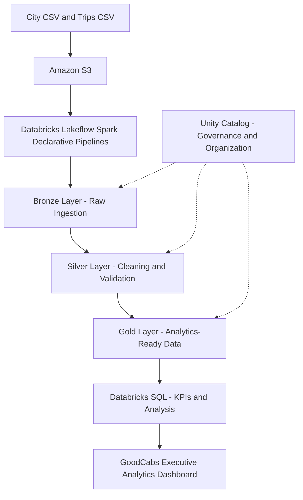

#  GoodCabs — End-to-End Data Engineering & Analytics — LakeFlow Spark Declarative Pipeline

The project transforms raw cab-trip data into structured, city-specific datasets and business insights, supported by SQL analysis and an executive analytics dashboard.


<p align="center">
  
  
  
  
  
</p>

---

## 1. Project Overview

GoodCabs is a simulated cab service operating across multiple cities in India. This project demonstrates how transportation data can be ingested, transformed, validated, and prepared for regional reporting and business analysis.

The project uses Databricks Lakeflow Spark Declarative Pipelines to organize data processing into Bronze, Silver, and Gold layers. The processed datasets support SQL-based analysis and city-level business reporting.

In addition to working with the data pipeline, I developed extra SQL queries, KPI calculations, data quality checks, and the **GoodCabs Executive Analytics** dashboard.

## 2. Business Problem

As a transportation business expands across multiple cities, teams need reliable and detailed information to understand operational performance.

The project addresses the following business challenges:

- **Delayed insights:** Business teams need timely access to trip and revenue information.
- **Limited regional visibility:** General reports may not provide enough detail for individual cities.
- **Manual data preparation:** Repeated data preparation can make reporting more time-consuming.
- **Data quality issues:** Invalid, incomplete, or duplicate records can affect analytical reliability.
- **Fragmented reporting:** Decision-makers need a consistent way to compare city performance, passenger categories, revenue, and service ratings.

### Project Objectives

- Build a structured data pipeline using Databricks.
- Ingest city and trip data stored in Amazon S3.
- Clean, standardize, and validate data across multiple processing layers.
- Prepare fact and dimension datasets for analytics.
- Create city-specific datasets for regional reporting.
- Develop SQL queries for business KPIs, trends, and data quality analysis.
- Build an executive dashboard to visualize important business metrics.
- 

## 3. Project Architecture

The project follows the **Medallion Architecture**, transforming raw source data into clean, structured, and analytics-ready datasets.



### Pipeline Flow

1. **Source:** City and trip CSV files are stored in Amazon S3.
2. **Bronze:** Source data is ingested into the initial processing layer.
3. **Silver:** Data is cleaned, standardized, and validated.
4. **Gold:** Processed data is organized for business analysis.
5. **SQL Analytics:** Queries calculate KPIs and investigate business trends and data quality.
6. **Dashboard:** Visualizations present business performance across cities and categories.

### Architecture Screenshot

\<!-- Replace the placeholder below with your actual architecture screenshot. -->

\<!-- ![GoodCabs Project Architecture]\(screenshots/goodcabs-architecture.png) -->

## 4. Data Pipeline Implementation

### 4.1 Bronze Layer — Raw Data Ingestion

**Purpose:** Ingest source data and make it available for downstream transformations.

- Ingests city and trip data from Amazon S3.
- Uses Databricks pipeline definitions to process source files.
- Captures ingestion metadata where configured.
- Supports incremental file ingestion through Auto Loader where implemented.
- Provides the source layer for Silver transformations.

**Pipeline files**

- `transformations/bronze/city.py`
- `transformations/bronze/trip.py`

**Bronze Layer Screenshot**

\<!-- ![Bronze Layer]\(screenshots/bronze-layer.png) -->

### 4.2 Silver Layer — Data Cleaning and Transformation

**Purpose:** Prepare consistent and validated datasets for analytical processing.

- Cleans and standardizes source data.
- Renames selected columns into consistent formats.
- Creates the City and Calendar dimension datasets.
- Applies configured data quality expectations.
- Validates business dates and rating values where defined.
- Prepares trip data for downstream analytical use.

**Data quality rules include**

- Business-date validation.
- Passenger ratings between 1 and 10.
- Driver ratings between 1 and 10.

**Pipeline files**

- `transformations/silver/city.py`
- `transformations/silver/calendar.py`
- `transformations/silver/trip.py`

**Silver Layer Screenshot**

\<!-- ![Silver Layer]\(screenshots/silver-layer.png) -->

### 4.3 Gold Layer — Business-Ready Data

**Purpose:** Provide structured datasets for business intelligence and regional analysis.

- Maintains the `fact_trips` dataset for trip-level analysis.
- Uses processed trip data with relevant city and calendar information for reporting.
- Creates city-specific Gold datasets for regional analysis.
- Supports analysis of trip volume, revenue, distance, and ratings.
- Provides datasets for SQL queries and dashboard visualizations.

**Key datasets**

- `transportation.gold.fact_trips`
- City-specific Gold datasets for Chandigarh, Coimbatore, Indore, Jaipur, Kochi, Lucknow, Mysore, Surat, Vadodara, and Visakhapatnam.

**Gold Layer Screenshot**

\<!-- ![Gold Layer]\(screenshots/gold-layer.png) -->

### 4.4 Lakeflow Spark Declarative Pipelines

The project uses Lakeflow Spark Declarative Pipelines to define data transformations and their dependencies declaratively.

**Key concepts explored**

- Declarative pipeline development.
- Pipeline dependency management.
- Incremental ingestion with Auto Loader where configured.
- Data quality expectations.
- Change data capture (CDC) concepts and flows where implemented.
- Structured processing through Bronze, Silver, and Gold layers.

**Pipeline Execution Graph**

\<!-- ![GoodCabs Pipeline Execution Graph]\(screenshots/pipeline-graph.png) -->

## 5. Medallion Data Modeling

| Dataset                | Layer  | Purpose                                                              |
| ---------------------- | ------ | -------------------------------------------------------------------- |
| City                   | Silver | Stores city identifiers and descriptive attributes                   |
| Calendar               | Silver | Provides date-related attributes and configured calendar information |
| Trips Fact             | Gold   | Supports trip-level business analysis                                |
| City-Specific Datasets | Gold   | Supports regional reporting and city-level comparisons               |

This structure supports analysis across cities, dates, passenger categories, revenue, trip distance, and service ratings.

## 6. SQL Analysis and Business KPIs

I extended the project with additional SQL queries in Databricks to investigate business performance and data quality.

| Analysis Area                   | Purpose                                                        |
| ------------------------------- | -------------------------------------------------------------- |
| Executive KPIs                  | Summarizes total trips, revenue, average distance, and ratings |
| Overall Performance             | Evaluates overall transportation metrics                       |
| City Performance                | Compares trip volume and revenue across cities                 |
| Passenger Category Analysis     | Examines trips and revenue by passenger category               |
| Monthly Trends                  | Analyzes changes in trip volume and revenue over time          |
| Weekday vs. Weekend             | Compares revenue by day type                                   |
| Service Quality                 | Evaluates passenger and driver ratings                         |
| City Rating Comparison          | Compares ratings across cities                                 |
| Revenue and Distance Validation | Investigates invalid or unexpected values                      |
| Data Freshness                  | Checks the latest available business date and data freshness   |
| Duplicate Checks                | Investigates duplicate records                                 |
| Data Completeness               | Checks for missing or incomplete data                          |

These queries connect the data pipeline to practical business questions and help evaluate the reliability of analytical results.

### SQL Analytics Screenshot

\<!-- ![GoodCabs SQL Analytics]\(screenshots/sql-analytics.png) -->

## 7. GoodCabs Executive Analytics Dashboard

I created the **GoodCabs Executive Analytics** dashboard in Databricks to present key performance indicators and business trends.

### KPI Cards

- Total Trips
- Average Trip Distance
- Average Passenger Rating
- Total Revenue
- Average Driver Rating

### Dashboard Visualizations

- Revenue by City
- Trips by City
- Trips by Passenger Category
- Revenue by Day Type
- Revenue by Passenger Category
- Monthly Revenue Trend
- City Rating Comparison

The dashboard combines summary metrics with detailed visualizations to help explore business performance across cities, passenger categories, and time periods.

### Executive Dashboard Screenshot

\<!-- ![GoodCabs Executive Analytics Dashboard]\(screenshots/goodcabs-executive-dashboard.png) -->

### Additional Dashboard Views

\<!-- ![City Performance Analysis]\(screenshots/dashboard-city-performance.png) -->

\<!-- ![Monthly Revenue Trends]\(screenshots/dashboard-monthly-trends.png) -->

## 8. Data Quality and Reliability

Data quality checks help identify issues that could affect business reporting.

The project includes or explores the following validation areas:

- Business-date validation.
- Passenger and driver rating validation.
- Revenue and distance validity checks.
- Duplicate-record checks.
- Data completeness checks.
- Data freshness monitoring.

Pipeline-level expectations validate records during processing, while SQL-based checks support further investigation of processed data.

## 9. Data Governance and Access Management

The project uses **Unity Catalog** to organize data within the `transportation` catalog.

- **Bronze schema:** Ingested source data.
- **Silver schema:** Cleaned and transformed data.
- **Gold schema:** Analytics-ready datasets.
- **Data permissions:** Unity Catalog supports permissions on data assets.
- **Regional reporting:** City-specific datasets can support appropriately scoped access when permissions are configured.

## 10. Technology Stack

| Technology                           | Purpose                                             |
| ------------------------------------ | --------------------------------------------------- |
| Databricks Free Edition              | Data engineering and analytics environment          |
| Lakeflow Spark Declarative Pipelines | Declarative pipeline development and execution      |
| Apache Spark / PySpark               | Data processing and transformation                  |
| Python                               | Pipeline implementation                             |
| SQL                                  | Business analysis, KPI calculations, and validation |
| Amazon S3                            | Cloud storage for source data                       |
| Delta Lake                           | Reliable table storage and data operations          |
| Unity Catalog                        | Data organization and access management             |
| Medallion Architecture               | Layered data processing                             |
| Git and GitHub                       | Version control and project documentation           |
| Databricks Dashboards                | Business performance visualization                  |

## 11. Repository Structure

```
goodcabs-data-engineering/
│
├── README.md
├── Project Setup.ipynb
│
└── transformations/
    ├── bronze/
    │   ├── city.py
    │   └── trip.py
    │
    ├── silver/
    │   ├── calendar.py
    │   ├── city.py
    │   └── trip.py
    │
    └── gold/
        └── City-specific transformation files
```

*This shows the main project structure. The Gold folder contains the actual city-specific transformation files in the repository.*

## 12. How to Explore the Project

To explore the existing project:

1. Review the README and project setup notebook.
2. Explore the Bronze, Silver, and Gold transformation files.
3. Review the corresponding pipeline in Databricks.
4. Inspect the tables in the `transportation` catalog.
5. Review the SQL queries used for KPIs, trends, and data quality.
6. Open the GoodCabs Executive Analytics dashboard.

To reproduce the project in another environment, you will need a compatible Databricks workspace, access to an Amazon S3 bucket containing the source files, appropriate catalog and storage configuration, and the required pipeline setup. Workspace-specific paths, connections, and permissions must be configured for that environment.

## 13. Key Learnings

- Designing a multi-layer data pipeline using the Medallion Architecture.
- Working with Databricks and Amazon S3.
- Using PySpark for data transformations.
- Understanding Lakeflow Spark Declarative Pipelines.
- Exploring incremental ingestion with Auto Loader.
- Applying data quality expectations and validation checks.
- Preparing fact and dimension datasets for analytics.
- Writing SQL queries for KPIs, trends, and comparisons.
- Building a dashboard to communicate business insights.
- Exploring data governance and access management.

## 14. Project Summary

GoodCabs demonstrates how raw transportation data can be transformed into structured datasets for regional reporting and business analysis.

The additional SQL queries, KPI calculations, data quality investigations, and Executive Analytics dashboard extend the project beyond pipeline processing by connecting the data to practical business questions.

**Project Domain:** Transportation Analytics\
**Project Type:** Data Engineering and Business Intelligence\
**Core Skills:** Databricks, PySpark, SQL, AWS S3, Data Quality, KPI Analysis, and Dashboard Development

## 15. About Me

Hi, I'm **Sejal Jha**, a Master of Data Science and Analytics student passionate about data engineering, cloud data platforms, SQL analytics, and building reliable data pipelines that transform raw data into meaningful business insights.

- **LinkedIn:** [Add your LinkedIn profile URL]
- **GitHub:** [Add your GitHub profile URL]
- **Email:** [Add your professional email address]

---

